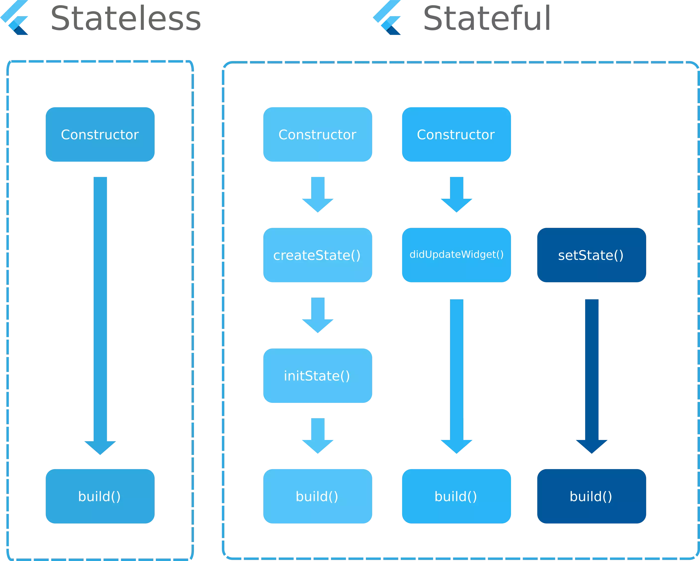

# 5. StatelessWidget, StatefulWidget y gestión del estado

*Fuente: [Unidad 4.01 - Widgets en Flutter - 5. StatelessWidget, StatefulWidget y gestión del estado](https://aules.edu.gva.es/fp/mod/book/view.php?id=11996459&chapterid=76812)*

Hasta ahora hemos construido interfaces que muestran información fija. Sin embargo, una aplicación también debe responder a las acciones del usuario: actualizar un contador, mostrar u ocultar información o cambiar el contenido de una pantalla.

Para conseguirlo necesitamos comprender qué es el **estado** de un widget y cómo podemos actualizarlo.



### 5.1. StatelessWidget: widgets sin estado mutable propio

Un `StatelessWidget` es un widget que no gestiona un estado interno mutable. Su contenido se construye a partir de los datos que recibe y del contexto de la aplicación.

Es adecuado para mostrar textos, tarjetas informativas, encabezados y otros componentes que no necesitan guardar cambios internos.

Por ejemplo:

```dart
class MensajeBienvenida extends StatelessWidget {
  const MensajeBienvenida({super.key});

  @override
  Widget build(BuildContext context) {
    return const Text(
      'Bienvenido a la aplicación',
      style: TextStyle(fontSize: 20),
    );
  }
}
```

Este widget muestra un mensaje y no necesita almacenar ningún dato que cambie por una interacción propia.

Esto no significa que un `StatelessWidget` nunca pueda actualizarse. Si recibe nuevos datos de su widget padre, Flutter puede volver a ejecutar su método `build()` para mostrar el contenido actualizado.

### 5.2. StatefulWidget: widgets con estado

Un `StatefulWidget` se utiliza cuando un componente necesita mantener información que puede cambiar durante su funcionamiento.

Ese estado puede representar, por ejemplo:

- El número de veces que se ha pulsado un botón.
- Si una opción está seleccionada.
- Si un apartado está visible u oculto.
- El resultado de una operación realizada por el usuario.

Un `StatefulWidget` se organiza mediante dos clases relacionadas:

- Una clase que extiende `StatefulWidget` y define el componente.
- Una clase que extiende `State`, donde se almacenan los datos que cambian y se construye la interfaz.

Su estructura básica es esta:

```dart
class MiContador extends StatefulWidget {
  const MiContador({super.key});

  @override
  State<MiContador> createState() => _MiContadorState();
}

class _MiContadorState extends State<MiContador> {
  int _contador = 0;

  @override
  Widget build(BuildContext context) {
    return Text('Contador: $_contador');
  }
}
```

Fíjate en sus elementos:

- `createState()` crea el objeto que gestionará el estado del widget.
- `_contador` es una variable que almacena el valor actual.
- `build()` construye la interfaz utilizando ese valor.

El guion bajo inicial en `_contador` y `_MiContadorState` indica que esos identificadores son privados dentro de su biblioteca Dart.

El ejemplo todavía no modifica el contador. Para hacerlo necesitamos incorporar una acción que cambie su estado.

### 5.3. Actualizar la interfaz con setState()

Flutter proporciona el método `setState()` para indicar que el estado interno de un widget ha cambiado y que su interfaz necesita actualizarse.

Por ejemplo, podemos crear un método que incremente nuestro contador:

```dart
void _incrementar() {
  setState(() {
    _contador++;
  });
}
```

Cuando se ejecuta este método:

1. Se incrementa el valor de `_contador`.
2. `setState()` avisa a Flutter de que el estado ha cambiado.
3. Flutter programa una nueva ejecución de `build()` para ese objeto de estado.
4. La interfaz refleja el nuevo valor del contador.

Es importante comprender que `setState()` no modifica directamente un texto ni sustituye manualmente un elemento visual. Actualizamos los datos y Flutter se encarga de reconstruir la parte correspondiente de la interfaz.

Si modificamos `_contador` sin llamar a `setState()`, el valor de la variable cambiará, pero Flutter podría no actualizar la pantalla en ese momento.

### 5.4. Ejemplo completo: contador interactivo

Vamos a crear una aplicación con un contador y dos botones. El primero incrementará su valor y el segundo permitirá reiniciarlo.

Abre `lib/main.dart` en un proyecto de prueba y sustituye su contenido por el siguiente código:

```dart
import 'package:flutter/material.dart';

void main() {
  runApp(const EjemploEstadoApp());
}

class EjemploEstadoApp extends StatelessWidget {
  const EjemploEstadoApp({super.key});

  @override
  Widget build(BuildContext context) {
    return const MaterialApp(
      debugShowCheckedModeBanner: false,
      home: PantallaContador(),
    );
  }
}

class PantallaContador extends StatefulWidget {
  const PantallaContador({super.key});

  @override
  State<PantallaContador> createState() =>
      _PantallaContadorState();
}

class _PantallaContadorState
    extends State<PantallaContador> {

  int _contador = 0;

  void _incrementar() {
    setState(() {
      _contador++;
    });
  }

  void _reiniciar() {
    setState(() {
      _contador = 0;
    });
  }

  @override
  Widget build(BuildContext context) {
    return Scaffold(
      appBar: AppBar(
        title: const Text('Gestión del estado'),
      ),
      body: Center(
        child: Column(
          mainAxisSize: MainAxisSize.min,
          children: [
            const Text(
              'Número de pulsaciones',
              style: TextStyle(fontSize: 18),
            ),
            const SizedBox(height: 12),
            Text(
              '$_contador',
              style: const TextStyle(
                fontSize: 48,
                fontWeight: FontWeight.bold,
              ),
            ),
            const SizedBox(height: 24),
            Row(
              mainAxisAlignment: MainAxisAlignment.center,
              children: [
                ElevatedButton(
                  onPressed: _incrementar,
                  child: const Text('Sumar'),
                ),
                const SizedBox(width: 12),
                OutlinedButton(
                  onPressed: _reiniciar,
                  child: const Text('Reiniciar'),
                ),
              ],
            ),
          ],
        ),
      ),
    );
  }
}
```

Ejecuta la aplicación con `flutter run -d chrome`, si Chrome está disponible como dispositivo, y comprueba el comportamiento de los botones.

Observa cómo hemos repartido las responsabilidades:

- `EjemploEstadoApp` es un `StatelessWidget` porque no necesita gestionar un estado mutable propio.
- `PantallaContador` es un `StatefulWidget` porque su contenido depende de un contador que cambia.
- `_contador` almacena el valor actual.
- `_incrementar()` y `_reiniciar()` modifican el estado mediante `setState()`.
- `onPressed` asocia cada botón con el método que debe ejecutarse al pulsarlo.

Fíjate también en `'$_contador'`. Esta expresión utiliza la interpolación de cadenas de Dart para convertir el valor de la variable en el texto que aparece en pantalla.

En el capítulo anterior aprendimos a crear widgets personalizados. A continuación veremos cómo comunicar las acciones entre componentes mediante callbacks.

### 5.5. El ciclo de vida de un StatefulWidget

El objeto `State` tiene un ciclo de vida. Flutter llama a determinados métodos cuando se crea, se actualiza o deja de utilizarse.

Por ahora, debes conocer estos tres:

- **`initState()`:** se ejecuta una vez cuando se inicializa el objeto de estado. Se utiliza para preparar información o recursos necesarios.
- **`build()`:** construye la interfaz. Puede ejecutarse varias veces durante la vida del widget.
- **`dispose()`:** se ejecuta cuando el objeto de estado se retira definitivamente. Permite liberar recursos que ya no se necesitan.

En nuestro contador no necesitamos sobrescribir `initState()` ni `dispose()`, porque no estamos gestionando recursos adicionales. En el capítulo 7 utilizaremos `dispose()` para liberar los controladores de los campos de texto.

**¿En qué orden se ejecutan estos métodos?**

Cuando trabajamos con un `StatefulWidget`, nos interesan dos situaciones. No ocurren a la vez: cada una responde a un motivo distinto.

1. **Primera creación del widget:** Flutter llama al constructor, ejecuta `createState()` para crear su objeto `State`, lo inicializa mediante `initState()` y construye la interfaz con `build()`. Es lo que sucede cuando aparece por primera vez nuestra `PantallaContador`.
2. **Cambio del estado interno:** nuestro código llama a `setState()` y Flutter programa una nueva ejecución de `build()`. Es lo que sucede cuando pulsamos *Sumar* en el contador.

Podemos resumirlo así:

```dart
1. Primera creación:
   Constructor → createState() → initState() → build()

2. Cambio del estado interno:
   setState() → build()

Al retirar el widget definitivamente:
   dispose()
```

El ciclo de vida completo incluye otros métodos que no necesitaremos en esta unidad.

**¿Quién llama a cada método?**

`initState()` y `dispose()` son métodos del ciclo de vida que Flutter ejecuta automáticamente. Podemos sobrescribirlos con `@override` para indicar qué debe ocurrir en esos momentos, pero no debemos llamarlos directamente para forzar una inicialización o actualización.

En cambio, `setState()` sí lo llamamos nosotros cuando modificamos el estado y necesitamos que la interfaz refleje el cambio. Si queremos repetir una tarea de preparación, conviene crear un método auxiliar propio y llamarlo cuando sea necesario.

En nuestro contador, al pulsar *Sumar*, se modifica `_contador` y se solicita una nueva construcción de la interfaz. No se vuelven a ejecutar `createState()` ni `initState()`, y el valor acumulado se conserva.

**¿Y qué ocurre con BuildContext?**

Tanto `StatelessWidget` como `StatefulWidget` pueden utilizar `BuildContext`, que representa la posición de un elemento dentro del árbol de widgets. La diferencia es cómo accedemos a él:

- En un `StatelessWidget`, `context` llega como parámetro de `build()`. Si otro método lo necesita, normalmente se lo pasamos como argumento.
- En la clase `State` de un `StatefulWidget`, existe una propiedad `context` disponible desde sus métodos mientras el estado siga montado.

Por eso, en una clase `State`, un método como este puede mostrar un mensaje sin recibir `context` como parámetro:

```dart
void _mostrarMensaje(String mensaje) {
  ScaffoldMessenger.of(context).showSnackBar(
    SnackBar(content: Text(mensaje)),
  );
}
```

No elegimos `StatefulWidget` por esta comodidad: lo elegimos cuando el componente necesita mantener un estado mutable propio.

**Documentación de consulta:** [Interactividad y gestión del estado en Flutter](https://docs.flutter.dev/ui/interactivity) y [referencia oficial del método setState()](https://api.flutter.dev/flutter/widgets/State/setState.html).
